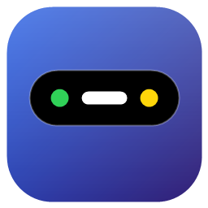
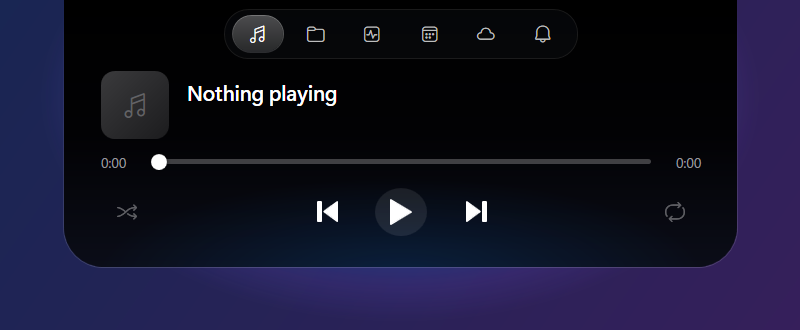
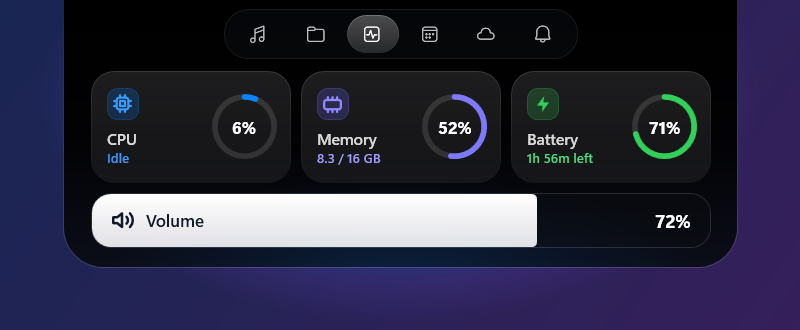
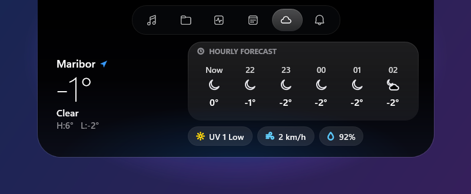
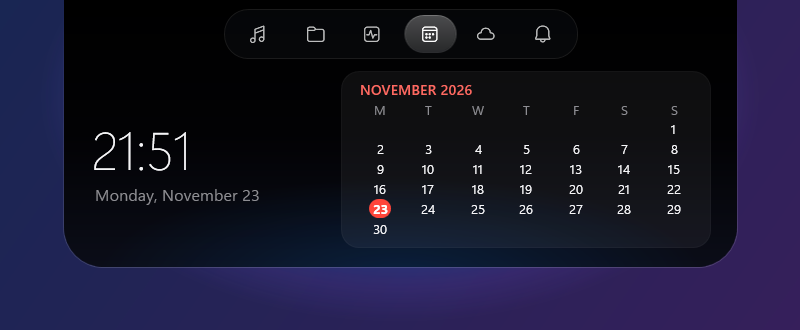
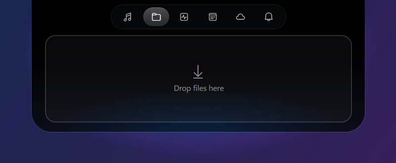
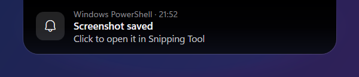

<p align="center">
  
</p>

<h1 align="center">NotchWin</h1>

<p align="center">
  A Dynamic Island–style notch for Windows 10/11: music, a file shelf, system stats, calendar,
  weather and notifications — always one hover away at the top of your screen.
</p>

<p align="center">
  
</p>

---

## Features

- **Live pill** – battery level (fills in proportion, green while charging), clock and the current outdoor weather.
- **Smooth, spring-based animations** – the notch grows and shrinks like a real island; interrupting it mid-way stays fluid.
- **Music** – title, artist, album art, seek bar, shuffle/repeat and playback controls for Spotify, browsers and any app that reports media to Windows.
- **File shelf** – drop files on the notch, then drag them out anywhere later.
- **System** – CPU, memory (GB used), battery (time left) and an iOS-style volume slider.
- **Calendar** – big clock, today's date and the current month.
- **Weather** – your city, hourly forecast, UV index, wind and humidity.
- **Notifications** – banners drop out of the notch; click one to open what it points to (e.g. the screenshot you just took). Clear one or all.
- **Stays out of your way** – the collapsed pill lets clicks through to the window beneath, hides over maximized and fullscreen windows (rest the mouse at the top edge to reveal it), and `Win + Alt + N` hides/shows it anytime.
- **Starts with Windows** and installs like a regular app (Start menu entry, uninstall from Settings).

## Screenshots

| Music | System |
|:---:|:---:|
|  |  |
| **Weather** | **Calendar** |
|  |  |
| **File shelf** | **Notification banner** |
|  |  |

## Install

Requirements: Windows 10 (19041+) or Windows 11 and the [.NET 10 SDK](https://dotnet.microsoft.com/download) to build.

```powershell
git clone https://github.com/SreckoIvanovic/NotchWin.git
cd NotchWin
.\Install.cmd
```

`Install.cmd` builds a single self-contained `NotchWin.exe`, installs it to `%LOCALAPPDATA%\Programs\NotchWin`
(no admin rights needed), adds a Start menu shortcut and an entry in **Settings → Apps → Installed apps**, and starts it.
Run it again to update. To uninstall, use **Settings → Apps → Installed apps → NotchWin → Uninstall**.

To just run it from source:

```powershell
dotnet run -c Release
```

## Usage

| Action | How |
|---|---|
| Open the notch | Rest the mouse on the pill for a moment |
| Switch tabs | Click the icons in the top bar |
| Keep a file | Drag it onto the notch; drag it out again to copy it anywhere |
| Open a notification | Click the banner or the item in the Notifications tab |
| Reveal over a maximized window | Rest the mouse at the very top edge of the screen |
| Hide / show | `Win + Alt + N` |
| Settings | Right-click the open notch |

**Tip:** to see notifications only in the notch (no Windows banners), turn on
*Settings → System → Notifications → Do not disturb* — notifications still reach the notification center, where NotchWin reads them.

## Settings

Right-click the open notch for:

- **Start with Windows** – on by default.
- **Auto-hide over maximized / fullscreen windows** – on by default.
- **Settings (weather city)…** – opens `%APPDATA%\NotchWin\settings.json`. Set `"City"` (e.g. `"Ljubljana"`) to use a fixed city
  instead of your Windows location.

## How it works

- **WPF on .NET 10** with WinRT APIs: `GlobalSystemMediaTransportControlsSessionManager` (media),
  `UserNotificationListener` (notifications), `Geolocator` (location).
- **NAudio** for the system volume.
- Weather from **[Open-Meteo](https://open-meteo.com)**, city name from **OpenStreetMap Nominatim**; coordinates are rounded
  to about 1 km before they are sent.
- Opening a clicked notification reads the toast's launch action from a copy of the Windows notification database
  (Windows' built-in SQLite) and activates it the same way Windows does.
- Start with Windows uses a per-user Task Scheduler sign-in task plus the classic `Run` entry as a fallback.

## Project structure

```
NotchWin/
├── MainWindow.xaml(.cs)        the notch: pill, tabs, animations, auto-hide
├── Spring.cs                   damped spring used for all motion
├── WeatherIcons.cs             vector weather icons
├── Services/
│   ├── MediaService.cs         now playing + controls
│   ├── AudioService.cs         system volume
│   ├── SystemStats.cs          CPU, memory, battery
│   ├── NotificationService.cs  reads Windows notifications
│   ├── NotificationActivator.cs opens a clicked notification
│   ├── WeatherService.cs       weather + forecast
│   └── Settings.cs             settings, start with Windows, log
├── installer/                  Install.ps1 / Uninstall.ps1
└── Install.cmd                 one-click install / update
```
